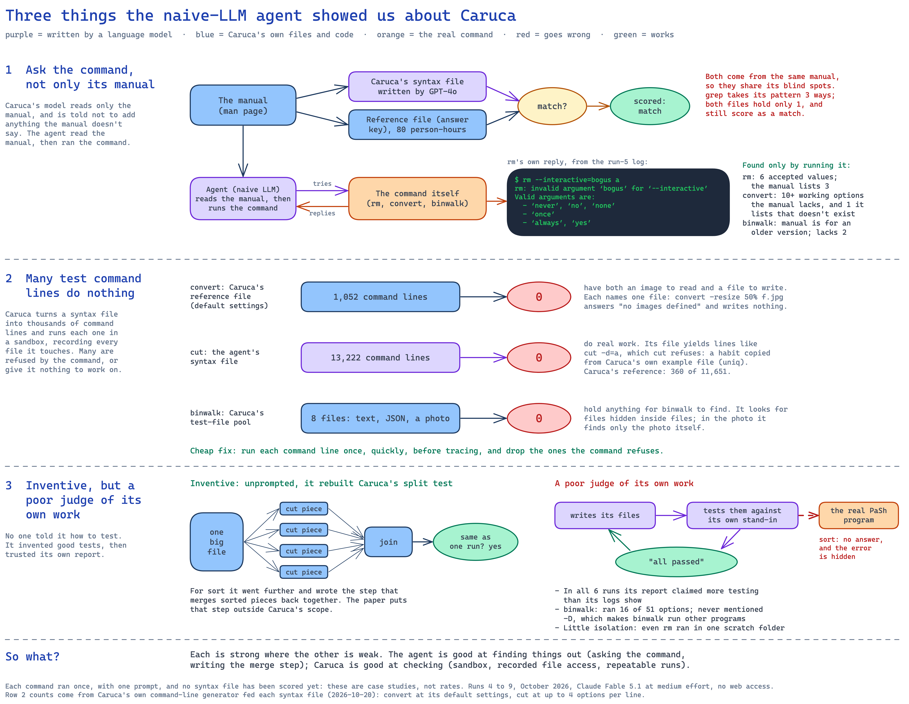

<!-- ATTRIBUTION-NOTICE:START -- required by LICENSE-TEMPLATES.md, do not remove -->
<!-- caruca_v2 analysis document. Created by Tiran Dagan. Copyright (c) 2026 Tiran Dagan.
     Licensed under the PolyForm Noncommercial License 1.0.0
     https://polyformproject.org/licenses/noncommercial/1.0.0
     Noncommercial use only. Commercial use is prohibited. -->
<!-- ATTRIBUTION-NOTICE:END -->

# Naive LLM vs Caruca: start here

**The project's current focus (since 20 October 2026).** A general-purpose coding agent (Claude Code,
model Claude Fable 5.1), given only the goal, two format descriptions and four finished examples, writes
the same syntax files Caruca (v1) produces. This page is the single entry point: what to read first, where
every piece of evidence is, every chart, and which older material is dated. Updated 2026-10-27; moved here
from `ai_docs/naive_llm_vs_v1/` the same day, so the experiment and the documents about it share one folder.
The [operator notes](#operator-notes-for-the-experimenter) (how the agent is set up and run, and the log of every
prompt version and run) follow below.

**The naive agent never sees this file or `observations.md`.** `sync_to_vm.sh` copies only the prompts,
`formats/` and `samples/` into a run's virtual machine, by name.

**Words used throughout.** A *syntax file* is the Python file describing a command's options, the kind of
value each takes, and the files it works on. Caruca keeps three kinds: its **answer key** (hand-curated
reference files, `syntax_specs/`), its **GPT-4o output** (what Caruca's own language-model step wrote,
`outputs/llm-dsl-generation/`), and, from this project, **the agent's** file from each naive run.

## 1. Read first

| Document | What it gives you |
|---|---|
| [**Observations: naive LLM vs Caruca**](observations.md) | The short answer: which is better in quality, which is faster, the score of every file, samples side by side, how the approaches are alike and different |
| [Latest findings](latest_findings.md) | Every finding of the project, dated, newest first, each linked to its evidence |
| [The three findings in one picture](diagrams/003_naive_llm_three_findings.png) | Ask the command, not only its manual · many generated test lines do nothing · inventive but a poor judge of its own work |



## 2. Where each answer lives

| Question | Document | Status |
|---|---|---|
| How was the agent set up (prompt, formats, examples, VM), and what did each run do? | [Operator notes](#operator-notes-for-the-experimenter), below (one "Observed, run N" entry per run, under [Prompt versions](#prompt-versions)) · design record [task 016](../ai_docs/tasks/016_naive_claude_code_arm.md) | current |
| What scores does each syntax file get? | [Task 018](../ai_docs/tasks/018_naive_vs_caruca_syntax_scoring.md) (method) · [scores table](scoring/results/summary.md) · one JSON per command with every count in [`scoring/results/`](scoring/results/) | current, 2026-10-27 |
| Exactly how do the three syntax files differ, checked on the program? | [Syntax files vs v1](syntax_files_vs_v1.md) (`rm`, `cut`, `sort`, `convert`) · scripts and raw results in [`comparisons/2026-10-26_syntax_files_vs_v1/`](comparisons/2026-10-26_syntax_files_vs_v1/README.md) | current, 2026-10-26 |
| What should the Caruca paper add? (written for the co-authors) | [Naive LLM addendum](white_paper_addendum_naive_llm.md) ([PDF](white_paper_addendum_naive_llm.pdf)), version 0.5 | current, 2026-10-27 |
| What did one run do, call by call? | the run's `analysis/analysis.md` (table below) | current |
| What does the agent cost, how long does it take, and how many of its tries does the program refuse, over all 79 commands in the paper's Fig. 7, beside Caruca? | [Task 019](../ai_docs/tasks/019_fig7_commands_naive_campaign.md) (plan); results will be in `fig7_campaign/results.md` | planned, 2026-10-27; not run |

## 3. The runs

One command per run, one run per command, prompt version 1, no web access from run 4 on. Times and costs
are the agent session's own figures (list price, billed to the subscription).

| Run | Date | Command | Time | Cost | Analysis | PDF | Diagrams |
|---|---|---|---|---|---|---|---|
| 3 | 2026-10-13 | `grep` (Claude Haiku 5.5, web on: context only) | 739 s | $0.96 | [analysis](runs/2026-10-13_193448_naive-run-grep_grep_PROMPT_v1/analysis/analysis.md) | — | [session](runs/2026-10-13_193448_naive-run-grep_grep_PROMPT_v1/analysis/session_workflow.png) · [information flow](runs/2026-10-13_193448_naive-run-grep_grep_PROMPT_v1/analysis/information_flow.png) |
| 4 | 2026-10-20 | `grep` (an example the agent was shown) | 322 s | $2.54 | [analysis](runs/2026-10-20_112956_naive-run-grep-noweb_grep_PROMPT_v1/analysis/analysis.md) | [PDF](runs/2026-10-20_112956_naive-run-grep-noweb_grep_PROMPT_v1/analysis/analysis.pdf) | [session](runs/2026-10-20_112956_naive-run-grep-noweb_grep_PROMPT_v1/analysis/session_workflow.png) · [information flow](runs/2026-10-20_112956_naive-run-grep-noweb_grep_PROMPT_v1/analysis/information_flow.png) · [Caruca's design vs agent](runs/2026-10-20_112956_naive-run-grep-noweb_grep_PROMPT_v1/analysis/v1_design_vs_agent.png) · [run 3 vs run 4](runs/2026-10-20_112956_naive-run-grep-noweb_grep_PROMPT_v1/analysis/run3_vs_run4.png) |
| 5 | 2026-10-20 | `rm` (an example the agent was shown) | 60 s | $0.80 | [analysis](runs/2026-10-20_121932_naive-run-rm_rm_PROMPT_v1/analysis/analysis.md) | [PDF](runs/2026-10-20_121932_naive-run-rm_rm_PROMPT_v1/analysis/analysis.pdf) | [session](runs/2026-10-20_121932_naive-run-rm_rm_PROMPT_v1/analysis/session_workflow.png) · [information flow](runs/2026-10-20_121932_naive-run-rm_rm_PROMPT_v1/analysis/information_flow.png) · [Caruca's design vs agent](runs/2026-10-20_121932_naive-run-rm_rm_PROMPT_v1/analysis/v1_design_vs_agent.png) |
| 6 | 2026-10-20 | `binwalk` (not a Caruca command) | 193 s | $2.12 | [analysis](runs/2026-10-20_133813_naive-run-binwalk_binwalk_PROMPT_v1/analysis/analysis.md) | [PDF](runs/2026-10-20_133813_naive-run-binwalk_binwalk_PROMPT_v1/analysis/analysis.pdf) | [session](runs/2026-10-20_133813_naive-run-binwalk_binwalk_PROMPT_v1/analysis/session_workflow.png) · [information flow](runs/2026-10-20_133813_naive-run-binwalk_binwalk_PROMPT_v1/analysis/information_flow.png) · [Caruca's design vs agent](runs/2026-10-20_133813_naive-run-binwalk_binwalk_PROMPT_v1/analysis/v1_design_vs_agent.png) |
| 7 | 2026-10-20 | `cut` | 104 s | $1.25 | [analysis](runs/2026-10-20_135253_naive-run-cut_cut_PROMPT_v1/analysis/analysis.md) | [PDF](runs/2026-10-20_135253_naive-run-cut_cut_PROMPT_v1/analysis/analysis.pdf) | [session](runs/2026-10-20_135253_naive-run-cut_cut_PROMPT_v1/analysis/session_workflow.png) · [information flow](runs/2026-10-20_135253_naive-run-cut_cut_PROMPT_v1/analysis/information_flow.png) · [Caruca's design vs agent](runs/2026-10-20_135253_naive-run-cut_cut_PROMPT_v1/analysis/v1_design_vs_agent.png) |
| 8 | 2026-10-20 | `convert` (ImageMagick) | 1,291 s | $6.04 | [analysis](runs/2026-10-20_135842_naive-run-convert_convert_PROMPT_v1/analysis/analysis.md) | [PDF](runs/2026-10-20_135842_naive-run-convert_convert_PROMPT_v1/analysis/analysis.pdf) | [session](runs/2026-10-20_135842_naive-run-convert_convert_PROMPT_v1/analysis/session_workflow.png) · [information flow](runs/2026-10-20_135842_naive-run-convert_convert_PROMPT_v1/analysis/information_flow.png) · [Caruca's design vs agent](runs/2026-10-20_135842_naive-run-convert_convert_PROMPT_v1/analysis/v1_design_vs_agent.png) |
| 9 | 2026-10-20 | `sort` | 304 s | $2.46 | [analysis](runs/2026-10-20_160340_naive-run-sort_sort_PROMPT_v1/analysis/analysis.md) | [PDF](runs/2026-10-20_160340_naive-run-sort_sort_PROMPT_v1/analysis/analysis.pdf) | [session](runs/2026-10-20_160340_naive-run-sort_sort_PROMPT_v1/analysis/session_workflow.png) · [information flow](runs/2026-10-20_160340_naive-run-sort_sort_PROMPT_v1/analysis/information_flow.png) · [Caruca's design vs agent](runs/2026-10-20_160340_naive-run-sort_sort_PROMPT_v1/analysis/v1_design_vs_agent.png) |
| 10 | 2026-10-26 | `dirname` (task 018 pilot) | 57 s | $0.88 | not analysed | — | — |

Runs 1 and 2 (`sed`, `grep`, 2026-10-13) used an earlier layout and their records no longer exist.

## 4. Charts and diagrams

Every diagram belongs to one of five kinds. Each run's diagrams sit in that run's `analysis/` folder,
linked in the table above, beside the `.excalidraw` source and the `.spec.json` it was built from.

| Diagram | What it shows | Where |
|---|---|---|
| The three findings | The project's three main naive-LLM findings on one page | [`diagrams/003_…png`](diagrams/003_naive_llm_three_findings.png) |
| Session workflow | One run as a timeline: each phase of the agent's session, how long it took, how many tool calls | each run, `session_workflow.png` |
| Information flow | What the agent read or ran, and which of its output files each source fed | each run, `information_flow.png` |
| Caruca's design vs the agent | Caruca's five jobs as the paper designs them, beside what the agent did for each | runs 4 to 9, `v1_design_vs_agent.png` |
| Run 3 vs run 4 | The same command with and without web access | run 4, `run3_vs_run4.png` |
| v2 system architecture (dated) | The September plan for the step-by-step rebuild, not the naive approach | [`001_…png`](../ai_docs/archive_2026-09_rebuild/diagrams/001_caruca_v2_system_architecture.png), [`002_…png`](../ai_docs/archive_2026-09_rebuild/diagrams/002_architecture_widescreen.png) |

## 5. Tools and raw data

| What | Where |
|---|---|
| Scoring tools (task 018): binary probe, program-checked facts, real-world reading, generator use | [`naive_llm_caruca/scoring/`](scoring/) (`score_t018.py` runs everything) |
| Comparison scripts (syntax files vs v1) | [`naive_llm_caruca/comparisons/2026-10-26_syntax_files_vs_v1/scripts/`](comparisons/2026-10-26_syntax_files_vs_v1/README.md) |
| Each run's full record (prompt, transcript, the agent's output files) | `naive_llm_caruca/runs/<run>/` |
| How to run one more command through the naive approach | [Operator notes, "Running a command with Claude"](#running-a-command-with-claude), below |

## 6. Background that still holds (facts about Caruca itself)

| Document | Last changed | What it establishes |
|---|---|---|
| [E0: artifact pinning](../ai_docs/analysis/e0_artifact_pinning.md) | 2026-10-13 | 82.7% of Caruca's generated test lines are repeats; the paper's three divergence claims checked |
| [What Caruca is for, and the grep case](../ai_docs/analysis/caruca_purpose_grep_case.md) | 2026-10-13 | Caruca's purpose (Greenberg); `grep`'s three pattern forms, one held by all of Caruca's grammars |
| [PaSh VM setup](../ai_docs/docs/pash_vm_setup.md) · [PaSh work scheduling](../ai_docs/analysis/pash_work_scheduling.md) | 2026-10-13 | How PaSh reads descriptions today; its speedups and their limits |
| [Caruca v1 pipeline instructions](../ai_docs/docs/caruca_v1%20pipeline%20instructions.md) | 2026-09-03 | How to run Caruca itself (Lima VM) |
| [The Caruca paper, transcribed](../ai_docs/refs/caruca_white_paper.md) | reference | The paper the comparison is measured against |

## 7. Dated: the step-by-step rebuild (September to early October 2026)

Before the naive approach, the project rebuilt Caruca's four steps one by one with GPT-4o (the "v2
pipeline"). Its findings still stand as recorded and several are in [Latest findings](latest_findings.md),
but it is no longer the focus, and some of its plans were overtaken. Read these only for that history.

| Document | Last changed | What it was |
|---|---|---|
| [Parity study](../ai_docs/archive_2026-09_rebuild/analysis/v1_v2_parity_study.md) | 2026-10-13 | v2 pipeline vs Caruca, step by step, nine commands |
| [v2 fidelity to v1](../ai_docs/archive_2026-09_rebuild/analysis/v2_fidelity_to_v1.md) | 2026-10-13 | How the rebuild matched Caruca's code |
| [Status report 2026-10-13](../ai_docs/archive_2026-09_rebuild/analysis/status_reports/status_report_2026-10-13.md) · [2026-09-22](../ai_docs/archive_2026-09_rebuild/analysis/status_reports/status_report_2026-09-22.md) | 2026-10-13 | Where the rebuild stood |
| [Addendum (rebuild)](../ai_docs/archive_2026-09_rebuild/analysis/white_paper_addendum.md) | 2026-09-29 | Proposals for the paper from the rebuild; superseded in focus by the naive-LLM addendum |
| [Experiment designs](../ai_docs/archive_2026-09_rebuild/analysis/experiment_designs.md) · [implementation plan](../ai_docs/archive_2026-09_rebuild/analysis/experiment_implementation_plan.md) | 2026-09-29 | Planned experiments for the rebuild; most never ran |
| [Evaluation gaps](../ai_docs/archive_2026-09_rebuild/analysis/evaluation_gaps.md) · [Scientific vs engineering contributions](../ai_docs/archive_2026-09_rebuild/analysis/scientific_vs_engineering_contributions.md) | 2026-10-13, 2026-09-29 | Early framing of what the paper leaves unmeasured |
| [Reflections on the 2023 proposal reviews](../ai_docs/archive_2026-09_rebuild/analysis/reflections_on_caruca_v1_submission_reviews.md) | 2026-10-13 | The NSF grant-proposal reviews (not the paper's reviews) |
| [v2 chain vs v1](../ai_docs/archive_2026-09_rebuild/docs/v2_chain_vs_v1.md) · [v2 pipeline usage guide](../ai_docs/archive_2026-09_rebuild/docs/caruca_v2_pipeline_usage_guide.md) · [v2 prompts inventory](../ai_docs/archive_2026-09_rebuild/docs/caruca_v2_llm_prompts.md) · [console walkthrough](../ai_docs/archive_2026-09_rebuild/docs/console_walkthrough_grep_rm.md) | 2026-09-13 to 2026-10-13 | Operating the rebuild |
| [Planning documents](../ai_docs/prep/) (master idea, roadmap, architecture, data schema, component functionality) and [the September handouts](../ai_docs/archive_2026-09_rebuild/docs/presentations) | 2026-09-29 | The August–September project plan |

---

# Operator notes (for the experimenter)

**These notes are for the experimenter. The Claude Code session must never see this file.**

The folder was called "Caruca via Claude Code CLI" until 2026-10-13 evening, when Tiran renamed it
`naive_llm_caruca`. Older commit messages and the deleted run-1 records use the old name.

## What this folder is

A third, deliberately minimal arm of the Caruca comparison. A fresh Claude Code CLI session is handed
a problem statement (one of the `PROMPT_v*.md` files), two format descriptions (`formats/`) and four
examples of finished output (`samples/`: v1's syntax files and PaSh's own annotation files,
byte-for-byte). Nothing about how v1 works. The experiment is to watch what an unguided session does
to produce the files: whether it reads the manual page it is pointed to, runs the binary, isolates it,
probes it with inputs, or simply writes from memory.

Design record and revision history: `ai_docs/tasks/016_naive_claude_code_arm.md` in the caruca_v2 repo.

What the session sees:

```
PROMPT_v1.md                   the task and nothing else; {{COMMAND}} is replaced per run
PROMPT_v2.md                   v1 plus three lines of behaviour guidance (see "Prompt versions")
formats/syntax_description.md  format of <command>.py, derived from v1's ir/syntax.py
formats/annotation.md          format of PaSh's three annotation files, derived from pash_annotations 0.2.4
                               (named pash_annotation.md until 2026-10-27, task 019)
samples/{tee,uniq,grep,rm}/    <cmd>.py from v1; annotation/ (pash/ until 2026-10-27) = PaSh's parser table + generator classes, verbatim
samples/PASH_ANNOTATIONS_LICENSE  MIT licence of the copied PaSh files
output/                        where the session writes its files (output/<cmd>.py and output/annotation/*; output/pash/* for runs before 2026-10-27)
runs/<date>_<time>_<vm>_<cmd>_<version>/   one folder per invocation of naive-run, collected: prompt.md (exactly as sent),
                               output/ (the deliverables), stream.jsonl (raw events), stream.actions.log (as shown on
                               screen), transcript_<session>.jsonl (Claude Code's own record), run.env, environment.txt
runs/<date>_<time>_<vm>_other-sessions/    sessions started in the clone outside naive-run (a bare `claude`); only written
                               when there are any; clones start with an empty session history

Operator tooling (never copied into a VM; sync_to_vm.sh stages only the prompts, formats/ and samples/):
new_run_vm.sh <name>           clone naive-golden -> <name>, start it, copy the package in fresh, install helper + welcome
collect_run.sh <name> [--keep] copy every run folder out of a clone into runs/, delete the clone (--keep to keep it)
sync_to_vm.sh [vm]             copy the package into a VM (used by new_run_vm.sh; run against naive-golden to update it)
vm/naive-run                   the in-VM helper: fills the placeholders and runs one session
vm/naive-watch.py              the live renderer for watch mode: prints each tool call, input and result; keeps raw + text logs
vm/bashrc-welcome.sh           the welcome printed on every interactive shell in a clone; lands you in ~/naive-arm
tool_log.py <log>              list every tool call (and -r: result) in a run's stream-json log or session transcript
excalidraw_fill.py <spec> <out> build an analysis diagram from a hand-placed spec (runs/*/analysis/*.spec.json are examples)
```

`tee`, `uniq`, `grep` and `rm` are the samples. They can still be run, but the session then has a
finished answer in front of it, so a run on one of them measures copying, not solving; record it as such.

## Michael's feedback and what changed (2026-10-13)

Prof. Michael Greenberg reviewed the first prompt (inline comments on Discord). His points, and what
each one changed:

| Feedback | Change |
|---|---|
| "What command lines it accepts" is odd; use the technical terms. | The prompt now says "argument syntax: the options it accepts, the type of each option's argument, and the types of its operands", and the syntax format document opens the same way. |
| The prompt needs to specify the path to the binary and the path to the manual page. | Two placeholders, `{{PATH}}` and `{{MANPAGE_PATH}}`, after the objective. The launch procedure fills them with `command -v` and `man -w` inside the VM. |
| The behaviour annotation should be Python code that inspects and reflects on the parsed arguments, as in PaSh's current grep annotation, not JSON. | The behaviour deliverable is now the form PaSh consumes today: under `output/pash/`, the parser table `<cmd>.json`, an `InputOutputInfoGenerator<Cmd>.py` class and a `ParallelizabilityInfoGenerator<Cmd>.py` class. `formats/pash_annotation.md` was rewritten from PaSh's source (`pash_annotations` 0.2.4) to describe all three. The parser table is included because PaSh cannot run a generator class without it. The syntax description stays in v1's Python DSL. |
| "Both files must follow their format exactly" is unnecessary. | Removed. |
| The samples should match the current annotations in github.com/binpash/annotations. | Sample annotations are now PaSh's own files, copied unchanged from the package installed in the pash VM (MIT; licence beside them). PaSh has no annotation for `bc`, so `uniq` replaced it; `tee` and `rm` have no parallelizability class upstream, which the format document explains as "not parallelisable". |
| Replace "how you arrive at the two files is entirely up to you" with: generate a correct spec without my intervention, and be certain to test the binary against the spec you generate. | Done, in both prompt versions. This puts one method instruction into version 1, which was previously silent about execution; the version-1 entry below says so. |

How this changed the approach: the deliverable is now something a current PaSh can load, not only a
file in v1's shape, so a run can be judged by consumption as well as by comparison. The sample set
is anchored to PaSh's repository rather than to v1's output. And the floor prompt now asks for a
tested specification, so "does it run the binary at all" is no longer the first question; "does it
run it before or only after writing" is.

## Prompt versions

**This section is the living record of the prompt variations.** Whenever a prompt is added or changed,
or a run shows how a version behaves, update the entry here in the same sitting. Each run uses
exactly one prompt file, and the run record names it. Everything else in the package (formats,
samples, output location) is shared by all versions, so a difference between runs is attributable to
the prompt, the command, or the model's own variability, and nothing else.

Each version is the previous one plus something. The table is the summary; the entries below it say
what was added, why, what we expect to change, and what the runs actually showed.

| Version | Adds | Still withholds |
|---|---|---|
| `PROMPT_v1.md` | the objective, the deliverable, the formats, the samples, the binary and manual-page paths, and one instruction: test the binary against the specification | how to find out what the command accepts, isolation, versioning, reproducibility |
| `PROMPT_v2.md` | a section "How the description must be established": execution not recall, probing as an experiment, OS and command version | documentation, isolation, tracing, how to decide the behaviour class |

### In every version since 2026-10-20: no web lookups, and a fixed model

**What was added.** Both prompt files were edited in place (not given new version numbers, because
this is a standing rule for every run rather than a new variable to compare) with a section placed
just before "Scope":

> **What you may not use.** Do not search the web or read anything online: no search engines, no
> websites, no code repositories. Work from what is on this machine. Programs that need the network
> to do their job, such as a package installer, may still use it.

At the same time `naive-run` began removing three tools from every session (WebSearch, WebFetch, and
RemoteTrigger, which starts cloud agents that can browse) and loading no MCP servers. It also began
fixing the model (see "Running a command with Claude"). The VM's network itself stays open. Each
run's `prompt.md` holds the exact text that was sent, so runs from before and after the change can
still be told apart.

**Why.** In run 3 (grep, below) the session used `curl` to search the GitHub API for "caruca", found
this public repository and read three of our memory notes, which shaped its answer. It did this from
the shell, not with the web tools, so removing the tools alone would not have stopped it; only the
prompt covers the shell. Tiran's call (2026-10-20): the agent must not search or browse, because
that can taint the result. Programs that need the network to do their job keep their access, so the
VM is not firewalled. Run 3 also ran on `claude-haiku-5-5`, the account's default, because no model was
set.

**What we expect.** No search or browsing: no requests to GitHub or to any website in the
session's shell commands. A session may still install a package (as run 3 fetched `pash-annotations`
from PyPI), and that request will show up in `bash_urls.txt`; whoever analyses the run decides which
URLs were installs and which were lookups. The withheld-word check passes on the new wording (it
avoids "documentation").

**Observed.** Run 4 (grep, v1, 2026-10-20; entry under PROMPT_v1): no URL in any shell command and no
attempt to reach PyPI or GitHub; the trial call chose Fable at medium effort. One run so far.

### In every version since 2026-10-27: PaSh no longer named in the prompt

**What changed.** Michael Greenberg edited `PROMPT_v1.md` in place (commit `89e1156`): the objective now
says "tools for reasoning about shell invocations" instead of naming PaSh, the behaviour files go to
`output/annotation/` instead of `output/pash/`, and the prompt refers to `formats/annotation.md` and
`samples/<cmd>/annotation/`. His commit changed only the prompt, so task 019 renamed the format document
and the four sample folders to match (they were `formats/pash_annotation.md` and `samples/<cmd>/pash/`),
and gave `PROMPT_v2.md` the same wording, so the two versions still differ by exactly version 2's
guidance section. The withheld-word check passes on both. Like the no-web rule, this is a standing edit,
not a new version number; each run's `prompt.md` shows which wording it got.

**What it does not change.** The materials still name PaSh: `formats/annotation.md` mentions it 6 times,
and the sample annotation files are PaSh's own and import `pash_annotations`.

**Why.** Greenberg: the prompt should not point the agent at one particular downstream tool.

**Observed.** No run yet; task 019 is the first campaign on this wording.

### PROMPT_v1 — the bare task

**What it contains.** The objective (describe the command's argument syntax and behaviour so that
programs reasoning about shell invocations can understand it without running it; PaSh was named here until
2026-10-27), the path of the binary and of its manual page, the
output files and their formats, the four samples, and the closing request: generate a correct
specification without intervention and be certain to test the binary against it.

**Why it exists.** It is the floor. It says nothing about how to find out what the command accepts or
how it behaves, nothing about isolation, nothing about versions. Since the 2026-10-13 review it does
carry one method instruction, "test the binary against the specification you generate", so it is no
longer silent about execution; v1 before that review said only "how you arrive at the files is up to
you". That earlier wording is kept in task 016's revision log, not as a live version.

**What we expect.** The session reads the manual page it was pointed to, writes the syntax file and
the generator classes from that, and then runs the binary at least enough to check them. Whether it
isolates anything before running a destructive command is the open question.

**Observed.** *Run 1, 2026-10-13, `sed`, interactive mode, clone `naive-run-grep`, Claude Code
2.1.296. Its records were collected and then deleted by Tiran the same evening, because the run came
from the leaky layout and the old helper; what follows is what was read off them before deletion,
and it is not reproducible from the repo.* About 8 minutes and 45 tool calls (37 Bash, 4 Write, 2 Edit,
2 Read). It produced all four files (syntax file 34 lines; parser table 71; input/output class 50;
parallelizability class 43). Its first Bash call listed the whole folder, and its second read
`PROMPT_v2.md` and the run's own `runs/sed_PROMPT_v1.env`, so a version-1 run saw version 2's
guidance and our metadata: a leak in the package layout, fixed the same day by moving prompts to
`~/prompts` and logs to `~/runs`. It then ran `sed --version`, read the manual page it was pointed
to, checked whether `caruca` or `pash_annotations` were importable, searched the filesystem for
them, and queried the GitHub API for repositories named "caruca" (the VM has network access). It
wrote and executed test scripts in its scratch directory and at the end deleted the compile caches
it had created under `output/`. Whether it ran `sed` on inputs before or only after writing the
files, and whether it isolated anything, was not read before the records were deleted. The operator
typed "status?" once, believing the session stalled; see "Interactive mode" below.

**Observed, run 2.** *2026-10-13 19:05, `grep`, watch mode, clone `naive-run-grep`, run 1 in that
clone, new layout. Collected to `runs/2026-10-13_190539_naive-run-grep_grep_PROMPT_v1/`. Not scored.
grep is one of the four samples, so the session had a finished answer in front of it.* 327 seconds,
34 turns, 33 tool calls (26 Bash, 5 Write, 2 Edit); the result event reports $0.32 at list price
(billed to the subscription). Its first three commands listed the folder, read both format documents,
and read grep's sample files. It then rendered the manual page it was pointed to, and spent calls 6
to 10 trying to install the `pash_annotations` package from PyPI (the stock image has no `pip`; it
found the package index reachable and listed versions 0.2.1 to 0.2.4). It invoked the grep binary
with patterns in 12 of its Bash calls. Its closing report claims 171 option cases checked against
grep 3.11 and 22 generator decisions confirmed, and says the syntax file could be checked only
against a stand-in for the `caruca` module. Output: syntax file 97 lines, parser table 54,
input/output class 43, parallelizability class 82. Whether it installed PaSh in the end, what the
"stand-in" was, and whether any run happened before the files were first written, is to be read off
the action log.

**Observed, run 3.** *2026-10-13 19:34, `grep`, watch mode, clone `naive-run-grep` (second clone of
that name), run 1 in that clone, model `claude-haiku-5-5`. Collected to
`runs/2026-10-13_193448_naive-run-grep_grep_PROMPT_v1/`; analysed in
[its `analysis/analysis.md`](runs/2026-10-13_193448_naive-run-grep_grep_PROMPT_v1/analysis/analysis.md)
with two diagrams. Not scored.* 739 seconds, 73 turns, 72 tool calls (43 Bash, 9 Write, 15 Edit,
4 Read, 1 TaskStop); $0.96 at list price. It read the manual page it was pointed to only for its
version header (first 1500 bytes) and took the option list from `grep --help`; it ran the binary 85
times on small files in a scratch directory under `/tmp`, with no other isolation, before writing
the first file at 19:41:53 (seven minutes in); it then wrote three check scripts of its own, ran the
real PaSh parser and classes from a `pash-annotations` 0.2.4 wheel it downloaded from PyPI (no
`pip` in the image, so it unpacked and read it), and fed one finding back into both generator
classes. It did not copy the sample: the parser table is the sample plus 30 entries (`-0`…`-9`
and the `--color=WHEN` spellings) minus the two `--color WHEN` options; the syntax file reuses the
sample's option inventory but has four syntaxes instead of one; both classes are rewritten. Its
syntax file imports under v1's real DSL. Three things to carry forward: Claude Code's shell defines
a `grep` function that runs its bundled ugrep, so the first `grep --version` reported ugrep 7.8.4
(the session noticed and used `/usr/bin/grep` by path); it searched GitHub for "caruca", found this
public repository and read three of our memory notes about grep, which shaped the four-syntax
structure; and no output file states the grep version. One claim in its report is wrong: the
sample's table already had `-y` and `-u`.

**Observed, run 4.** *2026-10-20 11:30, `grep`, watch mode, clone `naive-run-grep-noweb`, run 1 in
that clone, model `claude-fable-5-1` at medium effort (trial call succeeded), web tools and MCP
servers off, prompt carrying the no-web section. The same command and prompt version as run 3, so the
differences are the model and the no-web rule. Collected to
`runs/2026-10-20_112956_naive-run-grep-noweb_grep_PROMPT_v1/`; analysed in
[its `analysis/analysis.md`](runs/2026-10-20_112956_naive-run-grep-noweb_grep_PROMPT_v1/analysis/analysis.md)
with four diagrams. Not scored.* 322 seconds, 11 turns, 10 tool calls (all Bash); $2.54 at list price (billed to the
subscription), 24,495 output tokens of which 6,663 thinking. **No network use:** no URL in any
command (`bash_urls=0`). Its only search for the two packages was local: an import attempt, `pip
list`, and a `find` over the disk. It did not try PyPI. Order of work: listed the folder and read
both format documents and all four grep sample files (calls 1 to 4); checked the binary
(`/usr/bin/grep --version`, `type grep`, noticing again that the shell's `grep` is a function
running ugrep); rendered the manual page and pulled its option lines; then ran the binary 72 times
by path in calls 5 and 6, on small files under `/tmp` with no other isolation, before writing all
four files in one call at 11:33:54 (four minutes in). It then built a test harness with stand-in
`caruca` and `pash_annotations` modules that it wrote itself (no real PaSh, unlike run 3), checked the
option set against `--help` and the manual page, ran every option spelling through the binary,
and exercised both classes on 18 invocations. One reported failure (`-p`) was noise from its own
pattern-matching of the manual page, which it confirmed by running `grep -p` (rejected). Output: syntax
file 100 lines, two syntaxes (pattern operand; `-e`/`-f` with all operands files), against the
sample's one; parser table with **exactly the sample's flags and options** (formatting differs);
input/output class 43 lines (rewritten), parallelizability class 90 (sample 71; restructured from the
sample, keeping its placeholder names). Unlike run 3, three of the four files name GNU grep 3.11 (a
first version of this entry said none did; corrected after the analysis). It
lists five uncertainties (no way to express `-NUM`; bare `--color`; `-d recurse` reading the working
directory; include/exclude filters over-approximated; classes tested only against its stand-ins).
Compared with run 3: under half the time, a seventh of the tool calls, 2.6 times the cost; it ran the
binary about as often before writing; it did not fetch PaSh, so its classes were never run against
PaSh's real code.

*From the analysis (2026-10-20).* The closing report's "Everything passed" is not supported: the
harness's only run ended `TOTAL FAILURES: 1` (a `-p` the session's own pattern read out of the
manual), which the session explained away with a search that could not have found the source, and
did not rerun. The parser table and the syntax file disagree on `--color` (separate word versus
`=WHEN`; the probe in call 6 supports `=WHEN`). Like run 3, its first `grep --version` (call 2) reached
ugrep through Claude Code's shell function, and it switched to `/usr/bin/grep` within two calls.
Against the design in the Caruca paper, the session did all five of v1's jobs inside the model, chose
72 targeted probes where v1 generates a bounded space (122 invocations for grep at one flag),
observed printed output instead of system calls, and decided parallelizability by reasoning where v1
runs a split-input test. Tooling note: this run's `bash_urls.txt` holds one empty line instead of being
empty (fixed in `naive-run` straight after; `bash_urls=0` in `run.env` is correct).

**Observed, run 5 (rm, the first destructive command).** *2026-10-20 12:19, `rm`, watch mode, clone
`naive-run-rm`, run 1 in that clone, `claude-fable-5-1` at medium effort (trial call succeeded), web tools
and MCP servers off, the no-web prompt section in place. Same setup as run 4, so `rm` is the only
change. `rm` is a sample. Collected to `runs/2026-10-20_121932_naive-run-rm_rm_PROMPT_v1/`; analysed in
[its `analysis/analysis.md`](runs/2026-10-20_121932_naive-run-rm_rm_PROMPT_v1/analysis/analysis.md) (PDF
beside it) with three diagrams. Not scored.* 60 seconds, 6 turns, 5 tool calls (all Bash); $0.80 at list price;
4,623 output tokens of which 937 thinking. No URL in any command. **Isolation:** its only precaution was a
fresh scratch directory: call 3 begins `cd $(mktemp -d)`, creates its own files and directories there
(`a`…`h`, `dir/sub/x`, `empty`, a file named `-foo`), and runs `rm` 27 times on them through a small
wrapper that feeds `/dev/null` to standard input (so `-i` cannot wait for an answer) and prints each exit
code. No namespace, container or copy-on-write layer, and nothing aimed at protected paths
(`--preserve-root` was tried only on a scratch file). Its only other deletion was `rm -rf` of
`__pycache__` in `output/`. Order of work: listed the folder and read the syntax format (call 1);
read PaSh's format, the whole `rm` sample, `uniq`'s syntax and parallelizability files and `grep`'s
parallelizability class, then rendered the full manual page and ran `rm --version` and `--help`
(call 2); probed (call 3); wrote all four files in one call and checked they parse (call 4); removed
caches (call 5). **It did not test the files after writing them:** the only post-write check was that the
JSON loads and the Python compiles; the prompt's "be certain to test the binary against the specification
you generate" was met only by the probes that came before the specification. Output: parser table
**identical to the sample's** (same 10 flag entries and 2 options); syntax file = the sample plus three
changes the probes support (six `--interactive` values from the binary's own error message instead of
three; operands zero-or-more instead of at-least-one, because `rm -f` with no operand exits 0; a header
naming GNU coreutils 9.4 and listing the probe findings); input/output class = the sample's single line
plus standard output under `-v`, `--help` or `--version`; a parallelizability class that adds nothing
(the sample has none; absent means "not parallelizable", which the session said). Its report flags that
PaSh's table makes `--interactive` and `--preserve-root` consume the next word, which the probes show
is wrong for both (`rm --interactive never d` treated `never` as a file), and that it kept the sample's
shape anyway.

*From the analysis (2026-10-20).* The sample's `rm.py` is byte for byte v1's curated reference file
(`syntax_specs/rm.py`), and v1's own model output for `rm` matches it apart from formatting; the session's
two changes are supported by the binary, so a score against the reference would count them as errors.
The `mktemp` guard fails open (`cd $(mktemp -d) && t(){…}` with every probe on its own line: an empty
`mktemp` would send the batch to the home folder). Five probes reused a file an earlier probe had deleted,
so they show acceptance, not effect. The report's "a bare `--interactive` means always" is from the
manual, not a probe. Against the paper's design, whose running example is `rm` (8,749,056 invocation
configurations, each in its own traced layer, yielding pre- and post-conditions), the session ran 27
cases in one shared folder and stated no pre- or post-conditions; the prompt does not ask for them.

**Observed, run 6 (binwalk, the first command outside the core utilities).** *2026-10-20 13:38, `binwalk`
(Ubuntu package `binwalk 2.3.4+dfsg1-5`, installed in the golden image by Tiran the same day), watch mode,
clone `naive-run-binwalk`, run 1 in that clone, `claude-fable-5-1` at medium effort, web tools and MCP
servers off. Same setup as runs 4 and 5. binwalk is not a sample and not one of v1's 120 commands, so the
session had no finished answer and there is no v1 reference to score against. Collected to
`runs/2026-10-20_133813_naive-run-binwalk_binwalk_PROMPT_v1/`; analysed in
[its `analysis/analysis.md`](runs/2026-10-20_133813_naive-run-binwalk_binwalk_PROMPT_v1/analysis/analysis.md)
(PDF beside it) with three diagrams. Not scored.* 193 seconds, 19 turns, 18 tool calls (all Bash); $2.12 at
list price; 15,769 output tokens of which 3,120 thinking. No URL in any command. **`/usr/bin/binwalk` is a
Python script, and the session used binwalk's installed source as its main evidence:** it read the option
parser (calls 6 to 8) and in call 9 ran binwalk's own module code to print the program's internal option
table (51 options with types); the syntax file and parser table follow that table one for one. It compared
the manual (49 options, says 2.3.2) with `--help` (51, says v2.3.3) and found the manual lacks `-0` and `-1`;
it never queried the package version. It then ran the binary 30 times in one `mktemp` folder on a
gzip-plus-tar file it built (no stdin by default, pipes fail, `-f` appends, `-e` and `-J` create files, two
files add per-file headers), wrote all four files in one call at 13:40:30, and tested them mainly by
comparing them with the same internal table (circular), plus 4 more runs; one probe (`-h -q` still prints)
led to a fix. 16 of the 51 options were ever run; `-D`, `-r`, `-M`, `-0`, `-1` were not. Output: syntax file
87 lines (51 options, files zero or more), parser table 30 flags and 21 options, input/output class
(operands are non-streaming inputs; standard output unless `-q`, or with `-h`), parallelizability class that
adds nothing.

*From the analysis (2026-10-20).* Not in any file: `-D type:ext:cmd` runs a command per match (checked
afterwards in the clone), and the extraction folders `-e` creates cannot be declared in PaSh's input/output
class, so they appear only in comments. The report's "Stdin is never read" is contradicted by its own call
10 (`binwalk /dev/stdin < file` works), and of the five options it says accumulate when repeated only `-y`
was run repeated. The `mktemp` guard fails open again (`;` not `&&`), and the `-E -J` probe wrote
matplotlib's cache to `~/.cache`, outside the scratch folder. Against v1's design: v1's generator, fed the
agent's grammar, makes 122 invocations at one option and 7,282 at two, but the grammar's
`Integer(flag="-s", min=0, max=65535)` alone adds 65,536, because v1 tries every value in a range; and
binwalk finds nothing in seven of v1's eight content files and only the image header in the eighth, so at
v1's default text-only content every v1 run would print an empty table. This run also shows that packaged
commands are often readable scripts: prompt version 1 forbids online repositories but says nothing about
code installed on the machine.

**Observed, run 7 (cut, the first non-sample core utility).** *2026-10-20 13:52, `cut` (GNU coreutils
9.4), watch mode, clone `naive-run-cut`, run 1 in that clone, `claude-fable-5-1` at medium effort, web tools
and MCP servers off. Same setup as runs 4 to 6 (the golden image already carried run 6's `binwalk`
package). `cut` is not a sample. Collected to `runs/2026-10-20_135253_naive-run-cut_cut_PROMPT_v1/`;
analysed in [its `analysis/analysis.md`](runs/2026-10-20_135253_naive-run-cut_cut_PROMPT_v1/analysis/analysis.md)
(PDF beside it) with three diagrams. Not scored.* 104 seconds, 18 turns, 17 tool calls (9 Bash, 8 Read; it
turned to the Read tool after Claude Code's output limit cut its batch read down to a 2 KB preview
twice); $1.25 at list price; 9,117 output tokens of which 1,464 thinking. No URL in any command. It read
the formats and the `uniq`, `grep` and `tee` samples (never `rm`), the manual and `--help`, ran `cut` 21
times in `/tmp`, wrote all four files in one call at 13:53:55, then tested: 45 runs splitting a 5,000-line
file into chunks and comparing joined output with one run (the same idea as v1's `stateless` test,
unprompted), and its files against stand-in modules it wrote itself. Output: syntax file with **three
syntaxes, one per selector**, from the manual's "use one, and only one of -b, -c or -f" (v1's reference
and v1's model output leave all three optional); parser table = **PaSh's own `cut` table minus `-M`**
(never seen; GNU `cut` rejects `-M`); input/output class = PaSh's three calls; parallelizability class =
PaSh's, except no split under `-z`.

*From the analysis (2026-10-20).* Inside PaSh's real code (a copy of `pash_annotations` 0.2.4 in the pash
VM with the agent's files laid over it) the classes give PaSh's own answers except under `-z`, and the
session's claim that PaSh's parser leaves `-d:` among the files is true. The syntax file allows `-d` and
`-s` with `-b`/`-c`, which `cut` rejects (never probed), and copies the `uniq` sample's `=` marker onto
short options. Fed to v1's own generator at its shipped limit of 4 options, **none of the agent's 12,555
judged command lines does real work** (every accepted one carries `--help` or `--version`; the rest are
`cut -b=1`, `-d=a` and the like); v1's model output also gives 0, v1's curated reference 360 of 9,856. The
report's "every option … everything matched" is not supported (4 of 17 spellings never run), and its
"empty `--output-delimiter` gives a space, a quirk" is wrong: it is a NUL byte.

**Observed, run 8 (convert, the paper's costliest command).** *2026-10-20 13:58, `convert` (ImageMagick
6.9.12-98, Ubuntu package `imagemagick 8:6.9.12.98+dfsg1-5.2build2`, already in the golden image; the
exact version is in the run folder's `package_version.txt`), watch mode, clone `naive-run-convert`, run 1
in that clone, `claude-fable-5-1` at medium effort, web tools and MCP servers off. Same setup as runs 4 to
7. Not a sample and not one of v1's worked examples. Launched unattended with `printf 'y\n' | script -qec
"naive-run convert PROMPT_v1.md" /dev/null` (non-core command). Collected with `--keep`, clone deleted after
the analysis; `runs/2026-10-20_135842_naive-run-convert_convert_PROMPT_v1/`; analysed in
[its `analysis/analysis.md`](runs/2026-10-20_135842_naive-run-convert_convert_PROMPT_v1/analysis/analysis.md)
(PDF beside it) with three diagrams. Not scored.* 1,291 seconds of session time by Claude Code's measure,
but 2 h 14 min on the clock: the Mac's lid was closed on battery, so the Mac slept and froze the VM three
times; the session resumed correctly each time. 34 turns, 33 tool calls (31 Bash, 1 ToolSearch, 1
TaskStop); **$6.04** at list price; 46,065 output tokens of which 20,780 thinking. No URL in any command.
It read both formats, all four samples and the whole manual, compared the manual's 248 option names with
`-help`'s 250, then tried 352 words from ImageMagick's library as option names: **261 accepted**, 10 of them
in neither the manual nor `-help`, and the manual's `-connected-component` rejected. It measured how many
words each `-` and `+` form consumes (11 `-` and 3 `+` forms take two) and took 38 of its 40 value lists
from `convert -list`. About 3,700 runs of `convert` before writing, in a plain `/tmp/cvt` folder: one loop
hung on `-distribute-cache` until Claude Code moved it to the background, and a `pkill` matched its own
command line and ended its own shell. A generator script wrote the syntax file (426 option nodes, 522
spellings, inputs then one output) and the table (219 flags, 207 options); the classes were written by
hand (all operands but the last read, the last written; standard streams for `-`, `fmt:-`, `-identify`,
`-print`, `-write png:-`; not parallelisable). Its own harness then ran about 3,100 more binary runs
against stand-in modules.

*From the analysis (2026-10-20).* The report's "All 522 spellings passed" is not supported: 509 were run
and the last pass still flagged one (`+define`, a test artefact). Its "eleven undocumented options"
includes `-metric`, which the manual lists. Against v1: v1's curated reference and v1's model output both
hold exactly the manual's 248 names, the rejected `-connected-component` included, no `+` forms, and
`-view` as a flag (the binary gives it a value, checked in the clone). v1's committed `convert`
annotation has had no cases since 2024-12-04 (the 2024-11-28 version: "Found no successful runs.
Defaulting to side-effectful"), and v1 would generate 917,154 command lines at two options; the paper
projects 98.72 hours for those. **Inside PaSh's real code** (a copy of `pash_annotations` 0.2.4 in the pash
VM) both classes load and run, but PaSh's parser stops at the first file name, so in the usual
`convert in.png -resize 50% out.jpg` order `-resize` and `50%` are marked as input files, and
`-write side.png` after the input is marked as an input. **Through v1's own generator** (one option per
line, v1's defaults) the agent's grammar gives 2,422 distinct lines, and only the 4 without an option
have both an input and an output file: every option line has one file, which `convert` rejects ("no
images defined", checked in a throwaway clone on v1's `usenix.jpg`). v1's curated reference gives 0 such
lines and v1's model output (two single files) gives all 2,272. The syntax format allows more than two
positions (v1's own grammar for its PaSh tests is input, `-resize`, output), but every sample uses two and
the agent kept two; PaSh's table cannot express options after files or two-word options at all.

**Observed, run 9 (sort).** *2026-10-20 16:03, `sort` (GNU coreutils 9.4), watch mode, clone
`naive-run-sort`, run 1 in that clone, `claude-fable-5-1` at medium effort, web tools and MCP servers off.
Same setup as run 7. `sort` is not a sample. Collected to
`runs/2026-10-20_160340_naive-run-sort_sort_PROMPT_v1/`; analysed in
[its `analysis/analysis.md`](runs/2026-10-20_160340_naive-run-sort_sort_PROMPT_v1/analysis/analysis.md)
(PDF beside it) with three diagrams. Not scored.* 304 seconds, 24 turns, 23 tool calls (12 Bash, 11 Read);
$2.46 at list price; 23,977 output tokens of which 6,381 thinking. No URL in any command; a `find` over `/`
for `caruca` and `pash_annotations` found nothing. It ran `sort` 88 times before writing (all four files in
one call at 16:07:09), then about 960 times from two test scripts against stand-in modules: every option
spelling (the script ended `BAD = 8`, never mentioned), and 20 option sets split into 2, 3 and 5 parts,
sorted, merged with the command its class builds (`sort -m` plus the ordering options) and compared with
one sort (0 failures), plus a test showing round robin breaks `-s` and `-u`. Output: syntax file with 33
options (adds `-y` and the `--check` values); parser table = **PaSh's own `sort` table, argument access
kinds included, plus `-y` and `--check`** (never seen); input/output class = PaSh's logic plus no standard
output in check mode; parallelizability class: consecutive pieces and round robin merged by `sort -m …`,
round robin dropped under `-s`/`-u`.

*From the analysis (2026-10-20).* **Inside PaSh's real code the parallelizability class gives no answer
for any ordinary `sort`** (only `-s`/`-u` work): PaSh asserts that round robin may be paired only with
concatenation or an adjacent-lines aggregator, and catches the failure silently. The rule is not in
`formats/pash_annotation.md`, and PaSh's own `grep` sample builds the same pairing in a branch that never
runs; the session's stand-ins could not catch it. Its two stated doubts check out as follows: the option
accessors work; listing `--check` as an option does make PaSh take the next word as its value. Fed to v1's
generator at 2 options per line, 53% of the agent's judged lines are accepted (v1's reference 70%, v1's
model output 85%), the losses again from `=` after short options (`-t=:`, `-S=1k`). v1's committed `sort`
annotation calls all 6 of its cases `stateless`, which is false for `sort` in general; why was not
established.

**Observed, run 10 (dirname, task 018 pilot).** *2026-10-26 19:14, `dirname` (GNU coreutils 9.4, package
9.4-3ubuntu6.2), watch mode launched unattended (`echo y | script …`), clone `naive-run-dirname`, run 1 in
that clone, `claude-fable-5-1` at medium effort, web tools and MCP servers off. Same setup as runs 7 to 9.
Collected to `runs/2026-10-26_191443_naive-run-dirname_dirname_PROMPT_v1/`. Not analysed; scored by task
018 (`ai_docs/tasks/018_naive_vs_caruca_syntax_scoring.md`).* 57 seconds, 6 turns, 5 tool calls (all
Bash); $0.88 at list price (billed to the subscription); 4,768 output tokens of which 367 thinking. No URL
in any command. It read the formats, the `uniq`, `tee` and `rm` samples and `grep`'s PaSh classes, the
manual and `--version` (calls 1 to 3), ran `dirname` in `/tmp` on a dozen operand forms (call 3), wrote all
four files in one call (call 4), and checked them against stand-in modules it wrote (call 5). Output: a
syntax file with `-z`/`--zero`, `--help` and `--version`. The next pilot clone, for `dd` a minute later,
stopped before the session started: "OAuth session expired and could not be refreshed".

### PROMPT_v2 — execution is the standard

**What it adds.** One section with three points, placed between the samples and the closing scope
line:

1. parameters and behaviour must be derived from executing the command across all of its
   variations, not from memory or general knowledge;
2. the probing is an experiment: consider whether each observation is repeatable and whether the
   result would be reproducible by someone repeating the same runs;
3. core utilities differ in options and arguments between Unix flavours and versions, so establish
   which operating system and command version is in front of it and state that in the report.

Nothing else changes; the diff between the two files is exactly that section.

**Why it exists.** It is the smallest step away from naive that still says nothing about *how* to
execute. It names execution as the standard of evidence and raises the two concerns a careful
experimenter would have (reproducibility, platform dependence) without telling the session what to
do about them.

**What we expect.** The session should now derive the description from runs rather than from the
manual and only check afterwards, which forces it to confront isolation on its own for anything that
writes or deletes. The reproducibility point may lead it to repeat runs or
to note nondeterminism. The version point should make it record the OS and the command's version
string; the interesting question is whether it also realises the syntax file is therefore
version-specific.

**Observed.** No run yet.

### Adding a version

Copy the previous version to `PROMPT_v<n+1>.md`, make the change, and add an entry here with the same
four parts (contains or adds, why, expected, observed). Rerun the leakage check on the new file
(the operator notes in the design record, task 016, list the withheld words) and note which withheld
words the new version introduces. Add a line to task 016's revision log.

## The environment: a golden VM, cloned for every run

Runs happen in a throwaway clone of a **golden image**, a Lima VM named `naive-golden` that holds
nothing but Ubuntu 24.04, Claude Code and this package. The golden image is never run in; each run
starts from a fresh clone of it and the clone is deleted afterwards, so every run begins from a
byte-identical machine. Lima cannot roll a VM back on this Mac (snapshots are unimplemented on the vz
backend, and qemu is not installed), so cloning is the reset.

Why not the `caruca` VM, where v1's tracing runs: it has v1 installed in the guest home, the
user-namespace fix already applied, and the Mac home (both checkouts) mounted read-write. A session
there is naive by prompt but not by environment, and a destructive test command can damage the
tracing setup. Claude Code 2.1.296 is installed there too (2026-10-13), but it is not used for runs.

### What the golden image contains

Built 2026-10-13 with the steps below.

| Item | Value |
|---|---|
| VM | `naive-golden`, Lima template `ubuntu-24.04` (Ubuntu 24.04.4, arm64), vz backend, 4 vCPU / 4 GiB / 20 GiB, **no mounts** (`--mount-none`; there is no `/Users` inside) |
| Claude Code | 2.1.296, native installer, `~/.local/bin/claude` in the guest home `/home/tirandagan.guest`; on `PATH` in login shells |
| Package | `~/naive-arm`: `formats/`, `samples/`, empty `output/`, nothing else; the prompts in `~/prompts` and logs in `~/runs`, outside the session's folder (since run 1 showed the session reads everything in its folder); no README, no scripts |
| Sign-in | done 2026-10-13 (claude.ai account, Max subscription; `claude auth status` in the image confirms); every clone inherits it. The image's own session history (`~/.claude/projects`) was emptied on 2026-10-13 and each clone starts with it empty |
| Stock tools present | `strace`, `unshare`, `man`, `python3` (all in the stock cloud image); no `docker` |
| Stock restriction left in place | `kernel.apparmor_restrict_unprivileged_userns = 1`, so unprivileged user namespaces are blocked as on any stock Ubuntu 24.04; a session that wants a sandbox has to deal with that itself |
| Nothing from this project | no `CLAUDE.md` anywhere above `~/naive-arm`, no v1, no repo |
| Added 2026-10-20 | `binwalk` (`apt install`, package 2.3.4+dfsg1-5, with `python3-binwalk`; its manual says 2.3.2), installed by Tiran for run 6. `~/.config/binwalk/` (empty configuration files) was created in the image at 13:37 the same day by the analyst's `binwalk --help` check before cloning; binwalk creates it on its first run anyway |
| Changed 2026-10-27 (task 019) | **Ubuntu's automatic updates switched off** (`unattended-upgrades`, `apt-daily` and `apt-daily-upgrade` disabled): they ran inside every clone and changed package versions during a clone's life (coreutils, the C library, Python in a test clone). One full upgrade first, so the image is current as of 2026-10-27: kernel 6.8.0-147, **coreutils 9.4-3ubuntu6.3** (runs 4 to 10 had 6.2), diffutils 3.10-1ubuntu0.1, procps 4.0.4-4ubuntu3.3, sed 4.9, grep 3.11, bc 1.07.1, ImageMagick 6.9.12.98. **Added:** `uglifyjs` 3.17.4-2 (with nodejs 18.19.1), `unzip` 6.0-28ubuntu4.1, `pandoc` 3.1.3+ds-2 (three Fig. 7 commands that were missing), and `auditd` 3.1.2 (log files raised to 50 MB × 10) for the program-start logger; `bpftrace` 0.20.2 was already in the stock image. The prompt package was re-synced with the renamed `formats/annotation.md` and `samples/<cmd>/annotation/`. Claude Code left at 2.1.296; the session is started with its auto-updater off |

### Building the golden image (from scratch, on the Mac)

```sh
# 1. create and start: Ubuntu 24.04, no mounts
limactl create --name=naive-golden template:ubuntu-24.04 --mount-none --cpus 4 --memory 4 --disk 20 --tty=false
limactl start naive-golden --tty=false

# 2. install Claude Code (native installer; no Node needed)
limactl shell naive-golden -- bash -lc 'curl -fsSL https://claude.ai/install.sh | bash'
limactl shell naive-golden -- bash -lc 'claude --version'

# 3. copy the package in (README and sync script are left out by the script)
cd "$HOME/dev/stevens/caruca_v2/naive_llm_caruca" && ./sync_to_vm.sh naive-golden
```

**Sign in once** (by hand; the VM has no browser):

```sh
limactl shell naive-golden
claude          # then /login; open the printed URL on the Mac, paste the code back
exit
```

```sh
# 4. verify, then stop; the image is only ever started again to update it
limactl shell naive-golden -- bash -lc 'claude auth status | grep loggedIn; ls ~/.claude/CLAUDE.md 2>&1; cat ~/.claude/settings.json'
limactl stop naive-golden
```

**Updating the image** (new prompt version, changed sample, newer Claude Code): `limactl start
naive-golden`, make the change (`./sync_to_vm.sh naive-golden`, or re-run the installer line), `limactl
stop naive-golden`. Note the change in this README; clones made afterwards carry it, earlier runs did not.

## Running a command with Claude

### The short way (scripts)

```sh
cd "$HOME/dev/stevens/caruca_v2/naive_llm_caruca"
./new_run_vm.sh naive-run-sed-v2        # 1. fresh clone of naive-golden, package copied in fresh, helper installed
limactl shell naive-run-sed-v2          # 2. the welcome message lands you in ~/naive-arm and shows the commands
```

Inside the clone:

```sh
naive-run sed PROMPT_v2.md              # watch mode: runs unattended, every tool call / input / result shown live and logged
naive-run -i sed PROMPT_v2.md           # or Claude Code's own interactive screen (press Enter to send the prompt)
exit
```

**Task 019 additions (2026-10-27).** `naive-run -y <cmd>` answers the "not one of the core nine" question
(for batches). The program is found with `type -P` (for a shell built-in such as `test` or `kill`, the old
`command -v` printed the bare word). **OpenRouter billing:** when `~/.naive-billing` exists in the clone (written
by `fig7_campaign/run_campaign.py` just before the run, read and deleted by `naive-run`), the clone is signed out
of claude.ai and the session is sent to OpenRouter with that key and model (no trial call, no fallback), and
`naive-watch.py` stops it past the cost cap in the file; the key is passed by shell assignment, never as a
command argument (an argument of `env` showed up in the audit log in testing). **Program-start logging:** while
the session runs, an execve audit rule (`audit.log`, full arguments), an audit watch on `output/`
(`audit_output.log`, the first deliverable written) and `~/bin/exec-log.bt` (`tries.log`, parents, exit status,
start of error output) record every program start; `fig7_campaign/execlog.py` and `classify_tries.py` read
them. `collect_run.sh` scans every collected file for the OpenRouter key and redacts it. The whole campaign
procedure is task 019 (`ai_docs/tasks/019_fig7_commands_naive_campaign.md`).

**Model and restrictions, both modes.** Before the run starts, `naive-run` makes a one-line trial
call to `claude-fable-5-1` (about $0.02 at list price; it replaces the system prompt and loads no
tools, because a trial call with the full system prompt was measured at $3.02 on the Mac). If the
account can use Fable, the run uses `claude-fable-5-1` at medium effort; if not, it uses
`claude-opus-5-5` at high effort, and the refusal is written to `run.env` as `model_choice=fallback
(<reason>)`. No mid-run fallback: effort is set once per session, so a mid-run switch to Opus would
run it at medium effort and mix two models in one run. Every session is started with
`--disallowedTools WebSearch WebFetch RemoteTrigger --strict-mcp-config` (no MCP servers, so no
plugin servers and no claude.ai connectors, some of which can search). After the run, every
`http(s)://` URL in the session's Bash commands is written to the run folder's `bash_urls.txt`, its
count goes into `run.env` as `bash_urls=`, and the list is printed.

**Watch mode** is the default and the one to use for the record. The session runs non-interactively
(`claude -p`) with permissions bypassed, which is safe in a throwaway VM and the only way a
non-interactive session can use tools at all, and its event stream is rendered live: the model and
permission mode at the start, the assistant's visible text, each tool call numbered with its name and
input (for Bash, the exact command), each result truncated to 600 characters, and the totals at the
end. Thinking is not shown. The run folder (see above) holds `stream.jsonl` (the raw stream, complete), `stream.actions.log`
(what was shown on screen) and `transcript_<session>.jsonl` (Claude Code's own session transcript).

**Interactive mode** (`-i`) is Claude Code's normal screen. The prompt is placed in the input box
and is not sent until you press Enter (observed 2026-10-13: a session looked stalled until a key was
pressed). You answer each permission prompt yourself. The screen shows less than watch mode does;
the transcript still records everything.

Back on the Mac:

```sh
./collect_run.sh naive-run-sed-v2       # 3. copies every run folder into runs/ here and deletes the clone
```

Then fill in the "Observed" part of the prompt version's entry above and add the run to task 016.

`naive-run` accepts any installed command. A command outside the project's core nine (cat, grep, pwd,
rm, tac, tail, tee, uniq, wc, the commands every other arm was measured on) gets a warning and a
yes/no confirmation; one of the four samples (tee, uniq, grep, rm) gets a note that the session can
see a finished answer, and runs. To run a non-core command without an interactive shell (as for run 6),
answer the question through a pseudo-terminal: `limactl shell <clone> -- bash -lc 'cd ~/naive-arm && echo y |
script -qec "naive-run <cmd> PROMPT_v1.md" /dev/null'`. It refuses a command with no binary
or no manual page in the VM, an unknown prompt file, and a clone whose `output/` is not empty (one run
per clone).
It records the command, prompt version, binary path, manual-page path, mode, timestamps, Claude Code
version and OS in `runs/<command>_<version>.env`. `new_run_vm.sh` stops the golden image if it is
running (Lima clones only a stopped VM), and reports whether the clone is signed in and free of any
global `CLAUDE.md`.

### What the scripts do, by hand

1. **Clone and start** (*Mac*): `limactl clone naive-golden "$RUN" --tty=false && limactl start "$RUN" --tty=false`,
   then `./sync_to_vm.sh "$RUN"` so the package is the repo's current one, not the golden image's copy.

2. **Check the clone is clean** (*VM*): no `~/.claude/CLAUDE.md`; `~/.claude/settings.json` holds only a
   theme; `claude auth status` says logged in; `output/` is empty.

3. **Fill the three placeholders** (*VM*): the command, its binary's path (`command -v`) and its manual
   page's path (`man -w`):

   ```sh
   P=PROMPT_v2.md; CMD=sed; BIN=$(command -v "$CMD"); MAN=$(man -w "$CMD")
   fill() { sed -e "s|{{COMMAND}}|$CMD|g" -e "s|{{PATH}}|$BIN|g" -e "s|{{MANPAGE_PATH}}|$MAN|g" "$1"; }
   ```

4. **Run** (*VM*). Headless, with the complete machine-readable log (`stream-json` output requires
   `--verbose`, checked on 2.1.293 and 2.1.296):

   ```sh
   claude -p "$(fill "$P")" --output-format stream-json --verbose > "runs/${CMD}_${P%.md}.jsonl"
   ```

   The last event in the log has `"type": "result"` with token usage, cost, duration and turn count;
   every tool call and result is an earlier event. A headless run cannot answer questions; if the
   session stops to ask one, that is a result, and the interactive mode shows what it wanted.
   Interactive: `claude "$(fill "$P")"` starts the session with the prompt as its first message. To
   skip permission prompts, add `--permission-mode bypassPermissions` and record that you did.

5. **Collect and delete** (*Mac*): `limactl copy -r "$RUN:~/naive-arm/output" <dest>/output`, the same
   for `runs`, then `limactl delete -f "$RUN"`.

## Logging every tool call and command

There is no Claude Code flag that writes a tool log for an interactive session, but nothing is lost:

| Mode | Where every tool call and command is recorded | How |
|---|---|---|
| watch mode (`naive-run <cmd>`) | the run folder's `stream.jsonl` (raw) and `stream.actions.log` (as shown on screen) | `--output-format stream-json --verbose`: one JSON event per message; each `tool_use` block carries the tool name and its full input (for `Bash`, the exact command line), each `tool_result` the output; the final `result` event has tokens, cost and duration. `naive-watch.py` renders it live and keeps both files |
| both modes | the run folder's `transcript_<session-id>.jsonl` | Claude Code writes a transcript of every session to `~/.claude/projects/<cwd-slug>/<session-id>.jsonl` on its own, with the same `tool_use` / `tool_result` blocks plus timestamps; `naive-run` copies every session file written during the run into the run folder, and `collect_run.sh` saves any session started in the clone outside `naive-run` as `runs/<date>_<time>_<vm>_other-sessions/`; `new_run_vm.sh` empties the clone's session history at creation so inherited sessions never appear there |

To read either file as a plain list of calls (number, time, tool, command or path), on the Mac:

```sh
./tool_log.py runs/<date>_<time>_<vm>_<cmd>_<version>/transcript_<session-id>.jsonl
./tool_log.py -r ...      # also show each tool's result, truncated
./tool_log.py --json ...  # one JSON record per call, for scripts
```

Two more options exist and are not used: `claude --debug-file <path>` writes Claude Code's internal
debug log (noisy, not a tool log), and a `PreToolUse` hook in `~/.claude/settings.json` could append
every call to a file of our own, but that would put a hook into the environment the session runs in,
which the experiment keeps stock.

## Analysing a collected run: a prompt to start from

The idea: open a Claude Code session **on the Mac, in the caruca_v2 repo** (never in a VM), point it
at one collected run folder, and have it produce a written analysis plus workflow diagrams. The
diagrams use the Excalidraw skill from https://github.com/coleam00/excalidraw-diagram-skill, which
turns a description into an `.excalidraw` file and renders it to PNG for checking. The prompt below
installs the skill if it is missing, then runs the analysis. Replace the run folder path on the
first line. Treat the prompt as a starting point and refine it in place as analyses teach us what
to ask for.

One thing to know about the skill: its repository declares no licence (checked 2026-10-13). Tiran's
call, the same day, is to keep it in this repo anyway, under `.claude/skills/excalidraw-diagram/`,
alongside the other third-party skill (`impeccable`); it is listed with those exclusions in
`LICENSE-TEMPLATES.md` so nobody reads our licence as covering it. `uv`, which it needs, is on the Mac.

````markdown
Analyse one collected run of the naive Claude Code arm and produce a written analysis with workflow
diagrams. The run folder is: naive_llm_caruca/runs/2026-10-13_190539_naive-run-grep_grep_PROMPT_v1

**0. Set up the diagram skill (skip any step already done)**

The diagrams are made with the Excalidraw diagram skill. Check for `.claude/skills/excalidraw-diagram/SKILL.md`
in this repo. If it is absent, install it:

```sh
git clone --depth 1 https://github.com/coleam00/excalidraw-diagram-skill /tmp/excalidraw-diagram-skill
cp -r /tmp/excalidraw-diagram-skill .claude/skills/excalidraw-diagram
command -v uv >/dev/null || brew install uv
cd .claude/skills/excalidraw-diagram/references && uv sync && uv run playwright install chromium
```

Read the skill's SKILL.md before drawing anything, and follow its render-and-validate loop: every
diagram is rendered to PNG with `uv run python render_excalidraw.py <file>` from the skill's
`references/` folder, inspected, and fixed until it passes. Note the skill's licence in the analysis.

**1. What is in the run folder**

- `run.env`: command, prompt version, binary and man-page paths, mode, permission mode, timestamps,
  Claude Code version, OS, run number within the clone.
- `environment.txt`: Claude Code version, OS, architecture, account type.
- `prompt.md`: the prompt exactly as the session received it.
- `stream.jsonl`: every event of the session in order; each `tool_use` block has the tool name and
  full input, each `tool_result` the output, the final `result` event the turns, duration, cost and
  token counts. `stream.actions.log` is the same rendered as text.
- `transcript_<id>.jsonl`: Claude Code's own record of the session, with timestamps per record.
- `output/`: the deliverables: `<cmd>.py` (syntax description in v1's DSL) and `pash/` with the
  parser table `<cmd>.json`, `InputOutputInfoGenerator<Cmd>.py`, `ParallelizabilityInfoGenerator<Cmd>.py`.

`naive_llm_caruca/tool_log.py -r <file>` lists every tool call with its result. The README in
`naive_llm_caruca/` explains the arm; `ai_docs/tasks/016_naive_claude_code_arm.md` section 6 lists
the questions a run is meant to answer. Read both first.

**2. What to establish, each with evidence from the log (call numbers and timestamps)**

1. **Timeline and phases.** Segment the session into phases by what the calls do: orientation
   (listing and reading the folder), documentation (manual page or other sources), tooling attempts
   (installing packages, building test harnesses), probing the binary (running the command on
   inputs), writing the deliverables, testing them, reporting. For each phase: start and end time,
   number of calls, what it read or ran. Say in which phase the files were *first* written, and
   whether the binary was run before that point or only after.
2. **Sources it used.** The manual page it was pointed to, the samples, the format documents,
   anything from outside the folder (filesystem searches, network requests: name the URLs). If the
   command is one of the four samples, diff `output/<cmd>.py` and `output/annotation/*` (`output/pash/*` in runs before 2026-10-27) against
   `naive_llm_caruca/samples/<cmd>/` and say how much was copied versus derived.
3. **Isolation and safety.** Did it set up any isolation before running the binary (namespaces,
   containers, scratch directories, dry runs)? Did it run anything destructive? Where did it work?
4. **Testing.** What did it test, with what inputs, and what did it conclude? Check every claim in
   its closing report against the log (for example a count of cases checked) and say whether the
   log supports it.
5. **Reproducibility and versions.** Did it record the OS and the command's version, and does the
   output say which version it describes?
6. **Deliverable quality, mechanically.** Does `<cmd>.py` parse (`python3 -c "import ast; ast.parse(open(f).read())"`)?
   Do the PaSh classes parse? Does the parser table match the manual's options (list omissions and
   inventions)? Do not run the PaSh classes here; that needs the pash VM and is a separate step.
7. **Cost and effort.** Turns, tool calls by tool, duration, tokens, reported cost, from the
   `result` event.
8. **Behaviour worth recording** that the questions above do not cover: questions it wanted to ask,
   dead ends, retries, anything it did that the prompt did not ask for.

**3. Diagrams (with the skill)**

1. **Session workflow:** the phases from 2.1 as a left-to-right flow, each with its call count and
   duration, with loops where it iterated (write → test → fix), and the moment of first write marked.
2. **Information flow:** what went in (man page, binary runs, samples, format documents, outside
   sources) and which deliverable each fed, as a flow from sources to the four files.
Save both as `.excalidraw` and `.png` in `<run folder>/analysis/`.

**4. Write-up**

Write `<run folder>/analysis/analysis.md`: a one-paragraph summary, then sections 2.1 to 2.8 with
evidence, the two diagrams embedded, and a short list of what this run suggests we ask next. Plain
language: no shorthand a newcomer would not follow, every rate with its denominator. Then add a
one-paragraph summary with a link to the analysis under the matching prompt version's "Observed"
entry in `naive_llm_caruca/README.md`.

**5. Do not**

Do not change anything in `naive_llm_caruca/` other than `runs/<this run>/analysis/` and the README
entry. Do not touch the prompts, formats or samples: changing them is a change to the experiment and
goes through task 016's revision log. Do not copy anything into a VM.
````

## What to record per run

- command under test; prompt version; date; the clone's name and that it came from `naive-golden` (Ubuntu 24.04, arm64); `claude --version`
- model id, effort and permission mode used, and whether the Fable trial call failed and Opus was used instead (`run.env`: `model`, `effort`, `model_choice`)
- the URLs in the session's Bash commands (`bash_urls.txt`): which were package installs and which, if any, were lookups the prompt forbids
- wall-clock, input/output tokens, cost (from the `result` event)
- the run folder, collected with `collect_run.sh`
- observations, in these terms:
  - Did it read the command's documentation? Which source?
  - Did it set up any isolation before running the binary, or run it in place?
  - Did it try to observe reads and writes (system call tracing or similar), or reason them out?
  - How did it decide the behaviour class?
  - Did it try to run PaSh's parser or generator interfaces against its own classes, or install `pash_annotations`?
  - Did it stall on a question, and if so which one?
  (The command, prompt version, mode, timestamps and versions are already in the run folder's `run.env`.)

Bring the outputs back to the caruca_v2 repo under `eval/` (the Mac home is mounted in the VM, so
`cp` straight into `/Users/tirandagan/dev/stevens/caruca_v2/eval/...` works) for scoring against v1 and the ground truth;
the harness and scorers there already accept v1's two formats.
